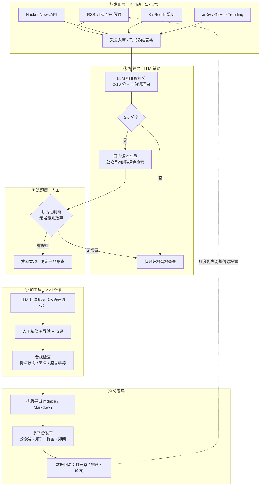
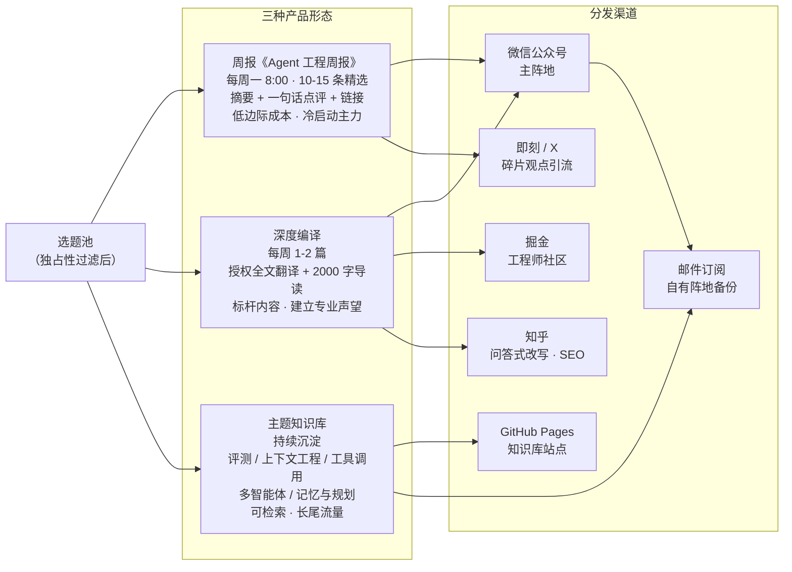
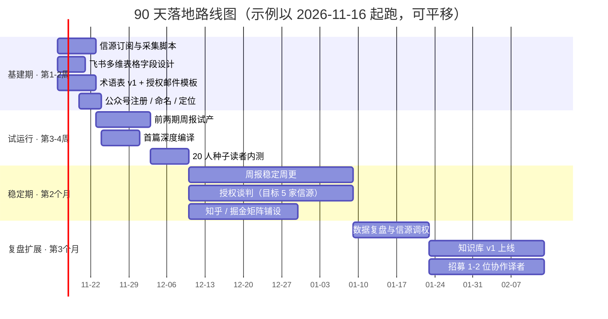

# 打破信息差：LLM / Agent 方向博客引进与分发全流程落地方案

> 版本 v1.0 · 2026-11-11
> 主题：大语言模型与 Agent 开发方向的海外一手技术内容引进（"博客搬运"）
> 目标：建立一套**合规、可持续、可自动化**的信源 → 加工 → 分发全流程管线

---

## 1. 机会分析：信息差到底差在哪

国内开发者与海外前沿之间的信息差是**三层叠加**的：

| 层次 | 表现 | 现状 |
|---|---|---|
| **语言差** | 海外一线工程博客（Anthropic Engineering、Simon Willison、Hamel Husain 等）大部分内容没有中文版 | 个人译者零星覆盖，无系统性 |
| **时差** | 英文原文发布 → 国内铺开，通常滞后 3~7 天，且多为媒体转述 | 转述过程失真严重，工程细节丢失 |
| **视角差** | 国内机构媒体（机器之心、量子位、新智元、AI 前线）偏**新闻/论文解读**视角 | 缺"动手做 agent 的人"关心的工程实操：评测、上下文工程、工具调用、踩坑 |

**竞争格局判断**：

- 机构媒体：快但浅、新闻导向、追热点模型发布，不追工程方法论；
- 个人译者（如长期坚持翻译海外 AI 内容的个人号）：证明"个人 IP + 翻译"路径可行，但选题随缘、不连续、无沉淀；
- **空档位**：面向 Agent 开发者的、**系统性 + 持续性 + 可检索**的一手工程情报。这个位置目前没有占满。

**建议定位（一句话）**：

> 面向"动手做 Agent 的人"的一手工程情报站——做**编译者 + 策展人**，不做新闻搬运工。

---

## 2. 合规红线（决定项目生死，必须先定）

"搬运"这个词在版权上是不成立的——**全文照搬即使署名也是侵权**，公众号/知乎会被投诉下架甚至封号。所以方案的第一性设计是：**用合规的内容获取模式换取长期生存**。

三种模式，按风险从低到高：

| 模式 | 做法 | 风险 | 适用 |
|---|---|---|---|
| **A. 摘要 + 导读 + 原文链接** | 200~500 字提炼核心观点，带自己的点评，链接原文 | 最低（合理引用范畴） | 周报、日常分发 |
| **B. 深度编译** | 基于原文的结构化改写 + 大量自己的解读增量 | 中（取决于改写深度与原作许可协议；CC-BY 署名可直接用） | 重磅单篇 |
| **C. 授权全文翻译** | 邮件获得作者书面授权后全文翻译，规范署名 | 最低（授权在手） | 头部信源的镇店内容 |

**关键行动项**：

1. **建立授权台账**（`auth_ledger.csv`）：对 P0 级信源逐个发授权邮件（模板见附录 A）。很多独立博主对"中文翻译 + 规范署名 + 回链"非常友好，谈判成本远低于想象；
2. **规范署名格式**：每篇编译/译文头部固定放「作者 / 原文链接 / 授权说明 / 译注说明」四要素；
3. **"原创"标记纪律**：公众号原创声明只用于自己写作比例足够的内容（导读 + 点评 + 改写为主体时才标）；
4. **收到投诉 24 小时下架机制**：先下架、再沟通，不硬扛；
5. **长期护城河**：目标是与 3~5 位头部博主建立稳定授权关系，甚至成为其"官方中文渠道"——这是别人抄不走的。

---

## 3. 信源体系（核心竞争力所在）

信源决定内容上限。按价值分层（完整可执行清单见 `信源清单.csv`，共 40+ 条）：

**第一梯队：独立技术博客（价值最高——有真实工程判断，非新闻稿）**

- Simon Willison（simonwillison.net）——LLM 应用工程第一信源
- Lilian Weng（lilianweng.github.io）——体系化综述，长文深度
- Hamel Husain（hamel.dev）——LLM 评测（evals）领域权威
- Chip Huyen（huyenchip.com）——系统与生产视角
- Eugene Yan（eugeneyan.com）——应用/推荐系统 + LLM
- swyx（swyx.io / latent.space）——"rise of the AI engineer"布道者
- Sebastian Raschka（magazine.sebastianraschka.com）——模型原理向
- Jason Liu（jxnl.co）——结构化输出/instructor 作者
- Karpathy（karpathy.github.io + YouTube）——教学与工程直觉

**第二梯队：实验室官方博客（一手，但偏发布向）**

- Anthropic Research + **Anthropic Engineering**（工程实践浓度极高，如 multi-agent 系统复盘）
- OpenAI Research + Cookbook（Cookbook 是实操金矿）
- Google DeepMind / Google Research
- Hugging Face Blog
- Meta AI / Mistral / Cohere / Qwen / DeepSeek（选读）

**第三梯队：Newsletter 与评论人（聚合与观点）**

- Latent Space（swyz）——工程向访谈 + 周报
- Interconnects（Nathan Lambert）——开源与模型经济学
- Last Week in AI——事件聚合（用于查漏，不直接编译）

**第四梯队：工程团队博客**

- Manus Blog（agent 工程复盘，浓度高）
- Vercel AI SDK Blog、LangChain Blog、Cursor Changelog（工具链动态）

**发现层（不经 RSS，作为雷达）**

- Hacker News（每日扫一遍 AI 相关热帖）
- X/Twitter 私有 List（把上述博主 + 研究员拉一个 List）
- arXiv cs.CL / cs.AI / cs.LG（只看被博客/讨论引用的论文，不直接啃论文）
- GitHub Trending（Python）、r/LocalLLaMA

**信源评分与复审机制**：每条信源按 `相关度 × 稀缺度 × 稳定性` 打分，季度复审一次——三个月内一条都没产出的信源降级或剔除，新的补进来。

---

## 4. 内容加工管线（全流程）



**人机分工原则**（这是可持续性的关键）：

- **机器做**：发现、采集、入库、相关度初筛、翻译初稿、格式化排版；
- **人只做四件事**：选题判断（独占性）、终审精修、授权与作者关系维护、评论区互动。

**独占性判断**是整个管线的灵魂——发布前先查国内是否已有译本：

- 已有高质量译本 → 放弃，不内卷；
- 已有但粗糙/删减严重 → 做增量编译，并指出自己的差异；
- 完全没有 → 抢时效（48 小时内出编译版）。

---

## 5. 产品形态与发布矩阵



**三种形态的分工**：

1. **周报（冷启动主力）**：边际成本最低、信任建立最快。固定每周一 8:00 发布，让读者形成"周一来我这看一眼这周发生了什么"的习惯；
2. **深度编译（声望内容）**：只做头部内容（如 Anthropic 的多智能体系统复盘这类），授权 + 全文翻译 + 自己的导读，一年沉淀 30~50 篇就是壁垒；
3. **主题知识库（长尾资产）**：把编译内容按主题重组（评测 / 上下文工程 / 工具调用 / 多智能体 / 记忆与规划），用 GitHub Pages 建可检索站点，吃搜索长尾流量。

**渠道适配要点**：

| 渠道 | 内容形态 | 适配动作 |
|---|---|---|
| 公众号 | 周报 + 深度编译 | mdnice 排版；头条放编译、次条放周报 |
| 掘金 | 深度编译 | 直接 Markdown，标题工程化（"如何做 X"） |
| 知乎 | 深度编译改问答 | 绑定已有高流量问题回答，吃 SEO |
| 即刻 / X | 碎片观点 | 周报单条拆发，引流公众号 |
| GitHub Pages | 知识库 | docusaurus/vitepress，作品集与求职名片双属性 |

**节奏纪律**：周更为主，不做日更。日更是精力黑洞且内容质量守不住——"固定节奏 + 每期保质"比"高频轰炸"涨粉更稳。

---

## 6. 自动化技术方案（可直接落地）

**工具栈**：Python + GitHub Actions（定时采集）+ LLM API（初筛/翻译）+ 飞书多维表格（选题库）+ mdnice（排版）。

**选题库（飞书多维表格）字段设计**：

`标题 / 作者 / 来源 / 原文链接 / 发布时间 / 摘要 / 相关度分 / 国内译本查重结果 / 授权状态 / 产品形态 / 状态（待筛→选题→加工中→待发→已发布）/ 排期 / 发布链接 / 数据表现`

**仓库结构建议**：

```
blog_reposting/
├── sources.csv               # 信源清单（单一事实来源，喂给采集脚本）
├── glossary.yaml             # 术语表（翻译一致性约束）
├── auth_ledger.csv           # 授权台账
├── pipeline/
│   ├── fetch_rss.py          # RSS + HN + arXiv 采集 → 写多维表格
│   ├── score.py              # LLM 相关度打分（prompt 内置评分标准）
│   ├── dedup.py              # 国内已有译本查重（站内搜索 API）
│   ├── translate.py          # 术语表约束的翻译初稿
│   └── export.py             # Markdown → 各平台排版导出
├── content/
│   ├── weekly/               # 周报 issue 归档（w2026-46.md ...）
│   └── features/             # 深度编译归档
└── .github/workflows/
    └── ingest.yml            # cron: 每小时跑一次 fetch + score
```

**关键脚本逻辑**：

- `fetch_rss.py`：`feedparser` 读 `sources.csv` 里的 RSS 地址，HN 用 Algolia API，arXiv 用官方 API；新条目去重后经飞书开放平台 API 写入多维表格；
- `score.py`：每条内容给 LLM 的 prompt 固定为"你是 Agent 开发领域的技术编辑，按与'LLM/Agent 工程实践'的相关度打 0-10 分并给一句话理由"，≥6 分才进入人工视野；
- `translate.py`：先加载 `glossary.yaml` 做术语约束翻译，产出带「译注标记」的初稿，人工只做终审。

**成本估算**：LLM API（初筛 + 翻译初稿）每月约几十元人民币量级；飞书多维表格、GitHub Actions（公开仓库）免费。**整个项目的边际成本主要是人的时间：每周约 6~10 小时**（周报 2~3h + 深度编译 3~4h + 运营互动 1~2h）。

---

## 7. 90 天落地路线图



**里程碑验收标准**：

- 第 4 周末：2 期周报 + 1 篇编译上线，种子读者 20 人，收到第一轮反馈；
- 第 8 周末：周报打开率 ≥ 25%，授权信源 ≥ 3 家，知乎/掘金开始有自然流量；
- 第 12 周末：知识库 v1（≥ 30 篇沉淀内容），周报稳定打开率 ≥ 30%，形成固定投稿/读者社群雏形。

---

## 8. 指标体系与风险对策

**北极星指标**：周报打开率（会话打开率，小而美账号健康基准 25%~40%）。

**过程指标**：完读率、转发/在看率（>3% 为佳）、知乎掘金长尾阅读、授权博主数（护城河指标）、读者群周活跃发言数。

**风险与对策**：

| 风险 | 对策 |
|---|---|
| 版权投诉 | 授权台账 + 摘要模式优先 + 24h 下架机制；模式 A/B/C 分级控制 |
| 公众号限流/封号 | 多平台矩阵分散 + **尽早建立邮件订阅**（自有阵地，平台无法没收） |
| 内容同质化（被机构媒体覆盖） | 独占性筛选机制：只做无译本/有增量的内容 |
| 精力不可持续 | 自动化管线 + 固定周更节奏 + 明确"不做日更"纪律 |
| 译者个人风格依赖 | 术语表 + 文风指南沉淀在仓库，可交接、可协作 |

---

## 附录 A：授权请求邮件模板（英文）

```
Subject: Permission to translate your post into Chinese

Hi {Name},

I'm {Your Name}, a developer based in China. I run a Chinese-language
publication focused on LLM & agent engineering ({Publication Name},
{Link}), aimed at hands-on developers in China.

I'd like to ask your permission to translate your post "{Post Title}"
({URL}) into Chinese for our readers. If you agree, we will:

1. Clearly attribute you as the original author with a link to the
   original post at the top;
2. Faithfully preserve your technical points, marking any translator
   notes separately;
3. Never put it behind any paywall — it stays free.

We think your writing on {specific topic} is exactly what Chinese
developers are missing right now. Would love to hear your thoughts.

Thank you!
{Your Name}
```

（中文版可对照写一份；独立博主回复率通常不低，尤其活跃在 X 上的作者。）

## 附录 B：核心术语表 v1（种子，持续扩充）

| 英文 | 推荐译法 | 备注 |
|---|---|---|
| context engineering | 上下文工程 | 已成共识 |
| tool use / function calling | 工具调用 / 函数调用 | 保留英文亦可 |
| agent | 智能体 / Agent | 首次出现标注，正文多用 Agent |
| agentic | 自主式 / agentic | 语境决定，不强译 |
| evals | 评测 | 不译作"评估" |
| scaffolding | 脚手架 | |
| agentic loop | Agent 循环 | |
| reasoning model | 推理模型 | |
| chain-of-thought | 思维链 | |
| retrieval-augmented generation (RAG) | 检索增强生成 | 首次标注 RAG |
| fine-tuning | 微调 | |
| RLHF | 基于人类反馈的强化学习 | 首次标注缩写 |
| guardrails | 护栏 | |
| observability / tracing | 可观测性 / 链路追踪 | |
| Model Context Protocol (MCP) | 模型上下文协议 | 首次标注 MCP |
| multi-agent system | 多智能体系统 | |
| token budget | token 预算 | token 不译 |
| context window | 上下文窗口 | |
| hit rate | 命中率 | 检索语境 |
| agent harness | Agent 执行框架 | 语境定夺 |

## 附录 C：信源清单

见同目录 `信源清单.csv`（可直接作为 `sources.csv` 喂给采集脚本），字段：类别 / 名称 / 地址 / 价值点 / 优先级 / 授权状态。
